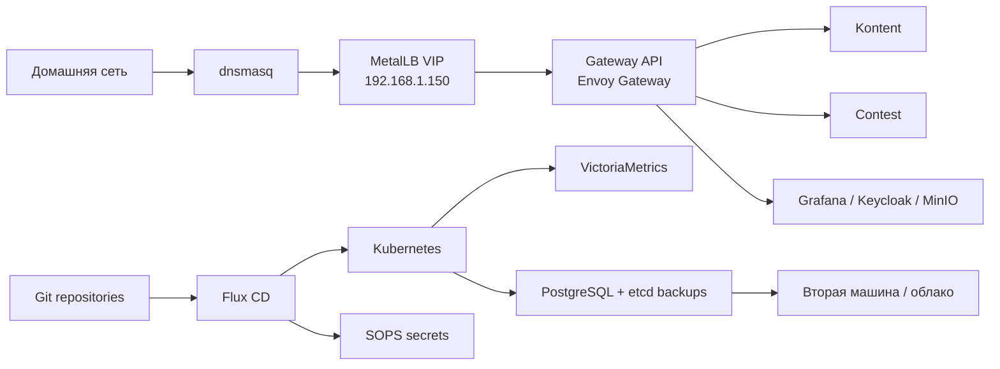

# Инфраструктурная дорожная карта homelab-кластера

Актуально на 31 октября 2026 года.

## Текущее состояние

В кластере уже есть хорошая основа:

- три control-plane узла с etcd;
- два worker-узла;
- Calico и NodeLocal DNS;
- cert-manager и локальный CA;
- VictoriaMetrics, Grafana и Alertmanager;
- GHCR и сборка образов через GitHub Actions;
- отдельные namespace для приложений `kontent` и `contest`;
- PostgreSQL и MinIO на статических iSCSI PersistentVolume.

Основные точки роста находятся вокруг входящего трафика, восстановления данных, доставки конфигурации и управления секретами.



## 1. Заменить NodePort и ingress-nginx

Сейчас внешний трафик проходит примерно так:

```text
DNS → 192.168.1.144 → NodePort 30443 → ingress-nginx
```

У этой схемы есть несколько ограничений:

- во всех HTTPS URL требуется порт `30443`;
- DNS привязан к адресу `w1.local.lan`;
- ingress-controller работает в одной реплике;
- отказ `w1` делает приложения недоступными, хотя `w2` продолжает работать.

Community ingress-nginx прекращён с марта 2026 года и больше не получает исправления безопасности. Kubernetes рекомендует переходить на Gateway API или другой поддерживаемый контроллер: [Ingress NGINX Retirement](https://kubernetes.io/blog/2025/11/11/ingress-nginx-retirement/).

Предлагаемый стек:

```text
MetalLB L2 + Envoy Gateway + Gateway API
```

MetalLB получает свободный адрес из локальной сети, например `192.168.1.150`. Gateway публикуется через Service типа `LoadBalancer`, после чего приложения становятся доступны на стандартном порту 443:

```text
https://kontent.local.lan
https://contest.local.lan
https://grafana.local.lan
```

В L2-режиме MetalLB объявляет VIP через ARP и может перенести его на другой узел: [MetalLB Layer 2 configuration](https://metallb.io/configuration/).

Envoy Gateway подходит к текущему Calico-кластеру без замены CNI. `Gateway`, `GatewayClass` и `HTTPRoute` входят в стабильную часть Gateway API: [Gateway API introduction](https://gateway-api.sigs.k8s.io/docs/introduction/).

Для gateway стоит использовать минимум две реплики с распределением по `w1` и `w2`.

## 2. Сделать проверяемые резервные копии

PostgreSQL и MinIO сейчас:

- работают в одной реплике;
- закреплены за `w1.local.lan`;
- используют статические iSCSI PV;
- имеют политику `Retain`.

`Retain` защищает PV от автоматического удаления, но не заменяет резервную копию.

Минимальная схема резервного копирования:

- ежедневный `pg_dump` обеих баз PostgreSQL;
- несколько поколений backup;
- копия за пределами основного NAS;
- регулярные snapshots etcd;
- резервная копия корневого CA cert-manager;
- резервная копия ключа SOPS/age после его внедрения;
- периодическая проверка полного восстановления.

Backup не должен храниться только в MinIO на том же физическом NAS. Отказ NAS в таком случае уничтожит исходные данные и их копию одновременно.

После отработки простого восстановления можно рассмотреть CloudNativePG. Он предоставляет:

- физическую репликацию PostgreSQL;
- автоматический failover;
- архивирование WAL;
- Point-in-Time Recovery;
- backup в S3-совместимое хранилище.

Документация: [CloudNativePG](https://cloudnative-pg.io/docs/current/).

## 3. Перейти от push-deploy к GitOps

Текущие процессы отличаются:

- `kontent` собирает образы и обновляет Deployment через SSH;
- `contest` публикует образы, а Deployment перезапускается отдельно;
- Kubernetes-манифесты частично применяются вручную;
- часть ресурсов использует тег `latest`.

Из-за этого Git не всегда полностью отражает состояние кластера.

Предлагается установить Flux и завести отдельный репозиторий состояния кластера:

```text
cluster/
├── infrastructure/
│   ├── metallb/
│   ├── gateway/
│   ├── cert-manager/
│   └── monitoring/
└── apps/
    ├── kontent/
    └── contest/
```

GitHub Actions в такой схеме:

1. запускает тесты;
2. собирает контейнер;
3. публикует контейнер с тегом commit SHA;
4. обновляет версию образа в Git либо передаёт это Flux Image Automation.

Flux самостоятельно приводит кластер к состоянию из Git. GitHub Actions больше не требуется SSH-доступ к управляющему узлу.

Образы следует фиксировать неизменяемыми тегами:

```yaml
image: ghcr.io/example/contest-front:a4c87e2
```

Вместо:

```yaml
image: ghcr.io/example/contest-front:latest
```

Это делает историю релизов понятной, а откат — воспроизводимым.

## 4. Зашифровать секреты

Если tracked-манифесты Kubernetes Secret когда-либо содержали настоящие пароли, удаления значений из текущего файла недостаточно: они могут оставаться в истории Git.

Для этого кластера подходит связка:

```text
SOPS + age + Flux
```

Secret остаётся YAML-файлом, но поля `data` и `stringData` хранятся зашифрованными. Flux расшифровывает их непосредственно перед применением: [Flux SOPS decryption](https://fluxcd.io/flux/components/kustomize/kustomizations/).

Ключ age следует хранить:

- в защищённом Secret внутри `flux-system`;
- в password manager или offline backup;
- отдельно от Git-репозитория.

Vault на текущем этапе добавит ещё одну критичную систему, которую также потребуется резервировать и восстанавливать. Для небольшого homelab SOPS проще и надёжнее.

## 5. Повысить доступность stateless-приложений

Сейчас основные Deployment работают в одной реплике:

```text
kontent api        1
kontent web        1
keycloak           1
contest api        1
contest frontend   1
ingress controller 1
```

Для frontend и API можно использовать две реплики и распределять их по worker-узлам:

```yaml
replicas: 2

topologySpreadConstraints:
  - maxSkew: 1
    topologyKey: kubernetes.io/hostname
    whenUnsatisfiable: DoNotSchedule
    labelSelector:
      matchLabels:
        app.kubernetes.io/name: example
```

Дополнительно стоит настроить PodDisruptionBudget, допускающий недоступность не более одной реплики.

Для Keycloak несколько реплик требуют настройки кластеризации. Сначала лучше:

1. заменить `start-dev` на production-конфигурацию;
2. настроить backup базы Keycloak;
3. проверить восстановление;
4. затем добавлять вторую реплику.

## 6. Улучшить storage

Статические iSCSI PV работают, но требуют ручного создания и привязывают инфраструктуру к конкретным манифестам.

Если TerraMaster предоставляет совместимый CSI-драйвер, он может дать:

- динамическое создание PV;
- общий StorageClass;
- изменение размера PVC;
- VolumeSnapshot;
- автоматическое подключение volume к другому worker.

Закрепление PostgreSQL и MinIO через `nodeSelector: w1.local.lan` ограничивает failover. Если iSCSI корректно настроен на обоих worker, следует отдельно протестировать перенос workload на `w2`, а затем убрать жёсткую привязку.

PVC VictoriaMetrics сейчас использует `local-path`. Потеря узла с этим volume приведёт к потере локальной истории метрик. Для homelab это может быть приемлемо, но должно быть осознанным решением.

## 7. Расширить наблюдаемость

Метрики и алертинг уже есть. Следующий полезный уровень:

- централизованные логи через VictoriaLogs или Loki;
- blackbox-проверки внешних URL;
- проверка DNS и TLS глазами клиента;
- алерты на окончание сертификатов;
- алерты на заполнение PVC;
- алерт на отсутствие свежего backup;
- уведомления Alertmanager в Telegram;
- dashboard состояния gateway и внешних приложений.

Blackbox-проверка полезнее обычного `Pod Ready`, потому что проверяет полный пользовательский путь:

```text
DNS → TLS → Gateway → Service → Pod
```

## 8. Добавить сетевую и workload-изоляцию

Calico уже позволяет постепенно внедрить NetworkPolicy:

```text
frontend → backend
backend → PostgreSQL
backend → Keycloak
остальной входящий трафик → запрещён
```

Полезные базовые меры:

- Pod Security Admission уровня `baseline`, затем `restricted`;
- `runAsNonRoot`;
- `seccompProfile: RuntimeDefault`;
- запрет privilege escalation;
- read-only root filesystem там, где это возможно;
- отдельные ServiceAccount;
- минимальные RBAC-права.

Политики стоит вводить поэтапно, сначала в audit/warn-режиме, чтобы не остановить существующие workload.

## Что пока не требуется

На текущем масштабе не стоит без конкретной задачи добавлять:

- service mesh;
- Kafka;
- Vault;
- распределённый MinIO;
- canary-операторы;
- сложную multi-cluster архитектуру.

Эти компоненты заметно увеличат операционную нагрузку, но почти не снизят текущие основные риски.

## Рекомендуемый порядок работ

1. Настроить backup PostgreSQL, etcd и CA и выполнить тестовое восстановление.
2. Установить MetalLB и получить стабильный VIP на портах 80/443.
3. Перейти с ingress-nginx на Envoy Gateway и Gateway API.
4. Внедрить Flux и SOPS.
5. Убрать `latest`, перейти на SHA-теги или image digest.
6. Увеличить frontend/API до двух реплик и распределить их по worker.
7. Добавить централизованные логи и blackbox-проверки.
8. Ввести NetworkPolicy и Pod Security Admission.

Первые четыре пункта дадут наибольший практический эффект: стандартный HTTPS без NodePort, отсутствие привязки входа к одному worker, воспроизводимое состояние кластера и безопасное хранение конфигурации.
